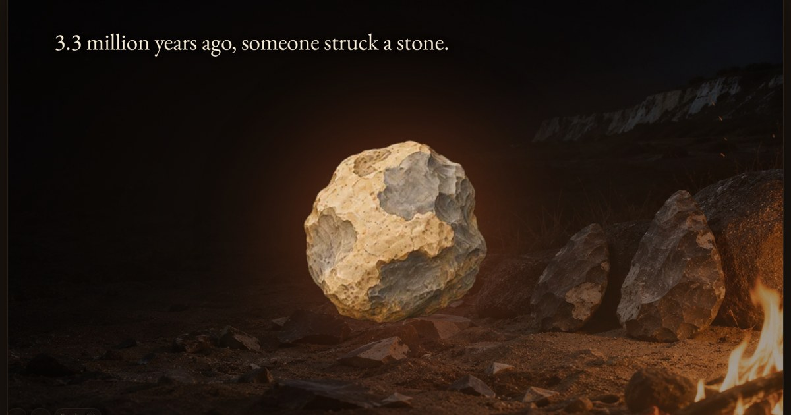

# Trial-and-error learning and the loss of hard toolmaking steps — an agent-based model

Dhairya Yadav · MSc Cognitive Science, IIT Delhi · SPL711 *Modelling Complex Adaptive Systems for Policy Analysis* (final project, 2026)

## What this is

An agent-based model of a population that makes a stone tool by striking stones. Agents learn
techniques by watching each other and, in one condition, by practising alone. Agents die and are
replaced, so the skill has to be passed on or it disappears. The model asks:

- **H1** — Are steps that are harder to perform (smaller tolerance for error) lost more often under social learning alone?
- **H2** — Does individual trial-and-error practice protect those steps?

The model builds on Falandays & Smaldino (2022) ("F&S"): agents represent each technique as a
Gaussian category and learn it with F&S's Bayesian classification and gradient rules. On top of
that it adds a physical world (techniques with real targets and tolerances; strikes can succeed,
miss or break the stone), a reduction sequence (stone states), route choice, and practice.
The full model description is the *Methods — Base Model V1* document; section numbers in the
code comments refer to it.

## Presentation



The talk is a single self-contained HTML file, [`presentation/index.html`](presentation/index.html):
download it and open it in any browser, no internet needed. It opens on the cold open. Keys: → / ← to move, **F** fullscreen, **S** speaker notes.

## Repository layout

```
model/v1.py              the model (numba-compiled simulate())
model/run_v1.py          parameter defaults + run() wrapper
experiments/experiments.py  all experiments in the report (main, noise, ofat, robust, lhs)
analysis/make_figures.py    every figure and summary table from results/*.json
tests/verify*.py         verification tests V1–V12; tests/verification_log.txt is the output
results/                 raw results (JSON, one record per run)
figures/                 figures + summary_tables.md
report/                  final report (docx + pdf)
presentation/            the talk: one self-contained HTML deck (open index.html in a browser)
legacy/                  F&S replication (model_main.py) and Part D (transition-matrix) code
```

## Install

```bash
python -m venv .venv && source .venv/bin/activate
pip install -r requirements.txt
```

## Reproduce

Run from the repository root (the scripts add `model/` to the path):

```bash
python tests/verify.py && python tests/verify2.py && python tests/verify3.py   # verification
python experiments/experiments.py main      # E1 tolerance x practice, 20 runs/cell
python experiments/experiments.py noise     # E2 motor x perception noise
python experiments/experiments.py ofat      # E3 one-factor-at-a-time sensitivity
python experiments/experiments.py robust    # E4 robustness (measure threshold, run length)
python experiments/experiments.py lhs       # E5 Latin-hypercube uncertainty analysis
python analysis/make_figures.py             # figures/ and figures/summary_tables.md
```

Every run is seeded (`numpy.random.seed(seed)` inside numba), so results are exactly reproducible.
Experiments are resumable: re-running skips settings already in `results/`. On one CPU core a
40,000-step run takes about 1 s (social only) or 6 s (with practice); the full set takes about 1.5 h.

## Default parameters

| Parameter | Value | Source |
|---|---|---|
| N, network | 50, fully connected | F&S |
| Lifespan (death prob. 1/lifespan), critical period | 10,000; 40,000 | F&S |
| σ_init, η_μ, η_σ, η_φ, α | 5, 1, 1, 0.001, 1 | F&S |
| K (technique Beliefs per transition) | 3 | > max. Real techniques per transition (2) |
| Tolerance easy / medium / hard | 10 / 6 / 4 | swept (E1) |
| Motor noise W, perception noise σ_obs, material σ_mat | 1.5, 3, 1 | swept (E2, E3, E5) |
| Route-choice β | 5 | swept |
| Practice: attempts n, nudge δ, rate η_P | 5, √(W²+σ_obs²), 0.1 | Truskanov & Prat (2018); swept |
| Start | seeded (main test of loss) | Methods §3.3 |

## Verification summary

See `tests/verification_log.txt`. Code-level checks (physics, success probability vs chi-square
theory, learning rule identical to F&S/Part D, determinism, practice switch, no-learning invariance)
all pass. Verification also found one design artefact: targets nearer the centre of strike space
were easier to acquire. All targets now sit 25 units from the centre (test V11).

## Provenance

`legacy/` contains the earlier thesis code: the F&S replication and the Part D transition-matrix
extension. `model/v1.py` is a new implementation of the V1 design that reuses F&S's learning rules
(checked numerically against Part D's functions in test V3).
